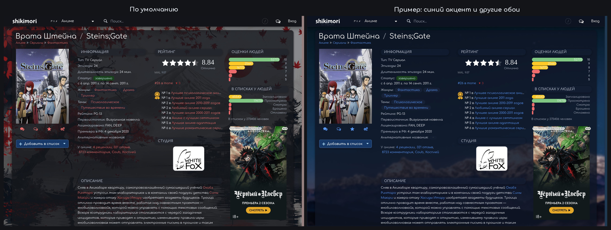

# shiki glass

Тёмная тема для [Шикимори](https://shikimori.io) и [shikimori.rip](https://shikimori.rip): мягкое стекло, графит, алый акцент. Работает на компьютере и на телефоне, на обоих сайтах из одних и тех же файлов. Текущая версия — **v1.6.5**.

<table>
  <tr>
    <td valign="top"></td>
    <td valign="top" width="240"></td>
  </tr>
</table>


## Установка

1. На Шикимори откройте профиль → «Настройки» → «Внешний вид сайта».
2. Откройте файл [site.css](https://github.com/Hikisey/shikimori-theme/blob/v1.6.5/site.css), скопируйте его **целиком** (кнопка копирования справа над кодом) и вставьте в поле стиля вместо того, что там было. В нём строки подключения темы и блок с настройками: обои, баннер профиля и цвета. Первая строка — комментарий со ссылкой на репозиторий, где лежат обновления: `https://github.com/Hikisey/shikimori-theme`.

3. Нажмите «Сохранить» и обновите страницу (Ctrl+Shift+R или на телефоне — обновление без учёта кеша, если оно есть).

Когда выйдет новая версия, замените в строках `@import` в начале стиля номер `v1.6.5` на новый со страницы [Releases](https://github.com/Hikisey/shikimori-theme/releases). Свои цвета, если вы их добавляли, можно оставить.

Если тема не появилась или Шикимори пишет «Не удалось импортировать», откройте [сброс кеша стилей](https://shikimori.io/tests/reset_styles_cache), вставьте туда ссылку из сообщения, сохраните стиль ещё раз и обновите страницу.

## Как сменить цвета, обои и баннер

По умолчанию тема алая. Чтобы перекрасить её, поменяйте значения в блоке «Палитра» в вашем стиле (он пришёл вместе с site.css). Цвета пишутся тремя числами через запятую, например `232, 108, 108`. Достаточно поменять `--accent` — кнопки, ссылки и подсветка перекрасятся сами.

Первые две строки примера (`@media` и `html:root`) лучше не трогать: без них на телефоне цвета могут не примениться.

| Строка | Что меняет |
| --- | --- |
| `--accent` | главный цвет: ссылки, кнопки, ник, подсветка |
| `--link` | только ссылки, если нужен отдельный цвет |
| `--bg-image` / `--bg-image-mobile` | обои на компьютере / на телефоне |
| `--bg-color` / `--bg-color-mobile` | цвет под обоями, пока они загружаются |
| `--bg-dim` | затемнение обоев: `0` — яркие, `1` — совсем тёмные |
| `--bg-blur` / `--bg-blur-mobile` | размытие обоев на компьютере / на телефоне |
| `--profile-banner` | картинка-баннер над профилем |
| `--profile-banner-height` | высота баннера на компьютере |
| `--glass` | цвет стеклянных блоков, меню и окон |
| `--glass-blur` | сила размытия под стеклом |
| `--text` | основной текст |
| `--text-2` | подписи и второстепенный текст |

### Пример: синий акцент и другие обои

Замените этими строками соответствующие значения в блоке «Палитра» (или вставьте блок в самый конец стиля). Слева — тема как есть, справа — с этим примером.

```css
@media screen and (min-width: 1px) {
  html:root {
    --accent: 90, 155, 255;
    --link: var(--accent);

    --bg-image: url("//cdn.jsdelivr.net/gh/Hikisey/shikimori-theme/bg_blue.webp");
    --bg-image-mobile: url("//cdn.jsdelivr.net/gh/Hikisey/shikimori-theme/bg_blue_m.webp");
    --bg-color: 33, 58, 84;
    --bg-color-mobile: 39, 61, 87;
    --bg-dim: .35;
    --bg-blur: 3px;

    --glass: 22, 32, 54;
    --glass-blur: 8px;

    --text: 236, 240, 247;
    --text-2: 170, 178, 192;
  }
}
```



В ссылке на свою картинку не должно быть символа `@` — иначе Шикимори её не покажет.

## Если что-то пошло не так

**Тема не загрузилась или осталась старая.** Обновите страницу с очисткой кеша (Ctrl+Shift+R). Если появилось «Не удалось импортировать», сбросьте ссылку на [этой странице](https://shikimori.io/tests/reset_styles_cache) и сохраните стиль ещё раз.

**На телефоне цвета не изменились, а на компьютере всё в порядке.** Проверьте, что вокруг ваших настроек остались строки `@media screen and (min-width: 1px)` и `html:root`, как в примере.

**Свои обои или баннер не видны.** Уберите из ссылки символ `@` и сохраните стиль снова.

## Благодарности

Основа темы — [E-design](https://github.com/ed-main) от [ed-main](https://github.com/ed-main).

Обои из синего примера — [Kanchenjunga South Peak](https://commons.wikimedia.org/wiki/File:Kanchenjunga_South_Peak_%28Unsplash%29.jpg) (Mukesh Jain, Unsplash, [CC0](https://creativecommons.org/publicdomain/zero/1.0/)).
