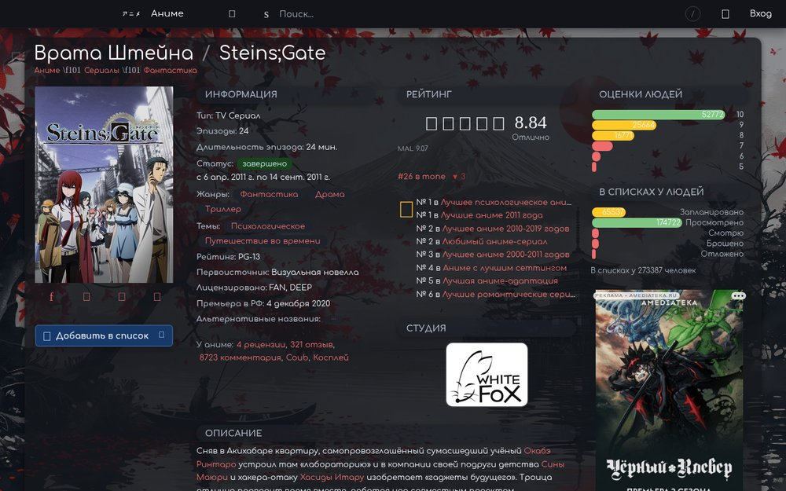
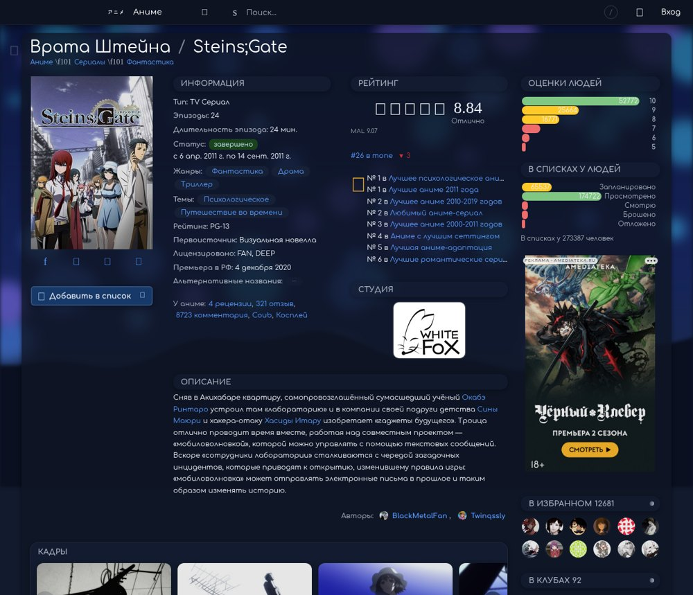

# hikisey theme

Тёмная тема для [Шикимори](https://shikimori.io): графит с алым акцентом, мягкое стекло, обои и баннер в профиле. Работает на ПК и на телефоне. Тема в разработке, текущая версия **v1.2.23**.



Спасибо [ed-main](https://github.com/ed-main) за основу.

## Установка

1. Откройте [`site.css`](https://raw.githubusercontent.com/Hikisey/shikimori-theme/v1.2.23/site.css) и скопируйте весь текст.
2. На Шикимори: профиль → «Настройки» → «Внешний вид сайта».
3. Замените всё в поле стиля скопированным текстом, нажмите «Сохранить» и обновите страницу (Ctrl+Shift+R).

Строки подключения (они уже стоят в начале `site.css`; `@import` всегда идут первыми):

```css
@import url("https://css-club.web.app/css/CodeMirror_dark.css");
@import url("https://css-club.web.app/css/custom_posters.min.css");
@import url("https://raw.githubusercontent.com/Hikisey/shikimori-theme/v1.2.23/css/part_01.css");
@import url("https://raw.githubusercontent.com/Hikisey/shikimori-theme/v1.2.23/css/part_02.css");
@import url("https://raw.githubusercontent.com/Hikisey/shikimori-theme/v1.2.23/css/part_03.css");
@import url("https://raw.githubusercontent.com/Hikisey/shikimori-theme/v1.2.23/css/part_04.css");
@import url("https://raw.githubusercontent.com/Hikisey/shikimori-theme/v1.2.23/css/part_05.css");
@import url("https://raw.githubusercontent.com/Hikisey/shikimori-theme/v1.2.23/css/part_06.css");
@import url("https://raw.githubusercontent.com/Hikisey/shikimori-theme/v1.2.23/css/part_07.css");
```

Чтобы обновиться, замените в этих строках номер версии на новый со страницы [Releases](https://github.com/Hikisey/shikimori-theme/releases). Если число файлов в новой версии другое, проще заново скопировать `site.css` (свою палитру сохраните).

Если Шикимори пишет «Не удалось импортировать», вставьте ссылку из сообщения на странице [shikimori.io/tests/reset_styles_cache](https://shikimori.io/tests/reset_styles_cache) и сохраните стиль ещё раз.

## Цвета, обои и баннер

Всё меняется в блоке «Палитра» из `site.css`. Цвета пишутся тремя числами `R, G, B`, остальные оттенки тема считает сама.

| Переменная | Что меняет | По умолчанию |
| --- | --- | --- |
| `--accent` | главный цвет: ссылки, кнопки, ник, подсветка | `232, 108, 108` |
| `--glass` | цвет стеклянных блоков, меню и окон | `30, 34, 42` |
| `--text` / `--text-2` | основной / второстепенный текст | `236, 240, 247` / `170, 178, 192` |
| `--bg-image` / `--bg-image-mobile` | обои на ПК / на телефоне | обои темы |
| `--bg-dim` | затемнение обоев, от 0 до 1 | `.5` |
| `--profile-banner` | баннер над профилем | нет |
| `--profile-banner-height` | высота баннера на ПК | `300px` |

Полный список с пояснениями — в комментариях [`site.css`](site.css). Пример: синий акцент и свои обои (ставится после строк `@import`, обёртку `@media` не удаляйте):

```css
@media screen and (min-width: 1px) {
  html:root {
    --accent: 90, 155, 255;
    --glass: 22, 32, 54;
    --bg-image: url("https://example.com/wallpaper.jpg");
    --bg-image-mobile: url("https://example.com/wallpaper-phone.jpg");
    --profile-banner: url("https://example.com/banner.jpg");
  }
}
```



В ссылках на картинки не должно быть символа `@`: Шикимори его вырезает.

## Для разработчиков

Устройство темы, сборка и правила правок — в [docs/ARCHITECTURE.md](docs/ARCHITECTURE.md) и [AGENTS.md](AGENTS.md).
