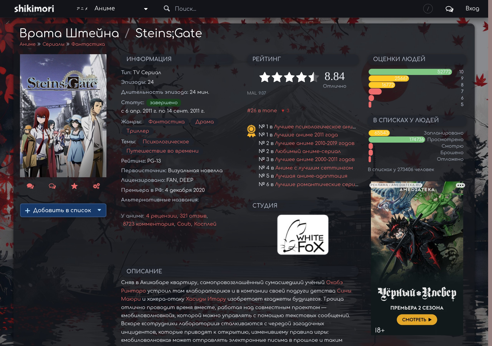
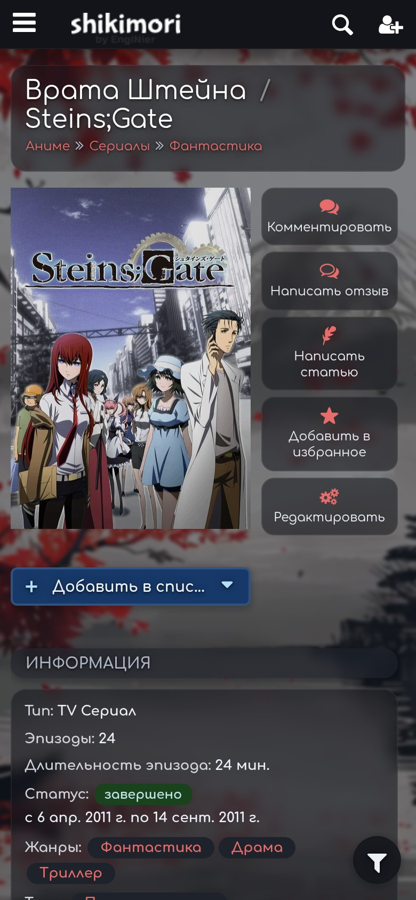
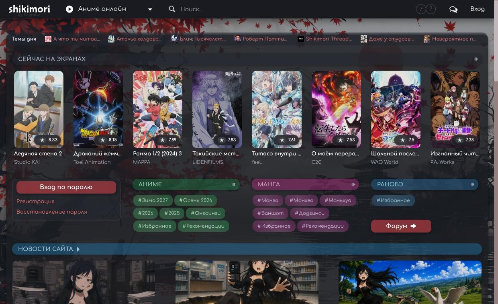
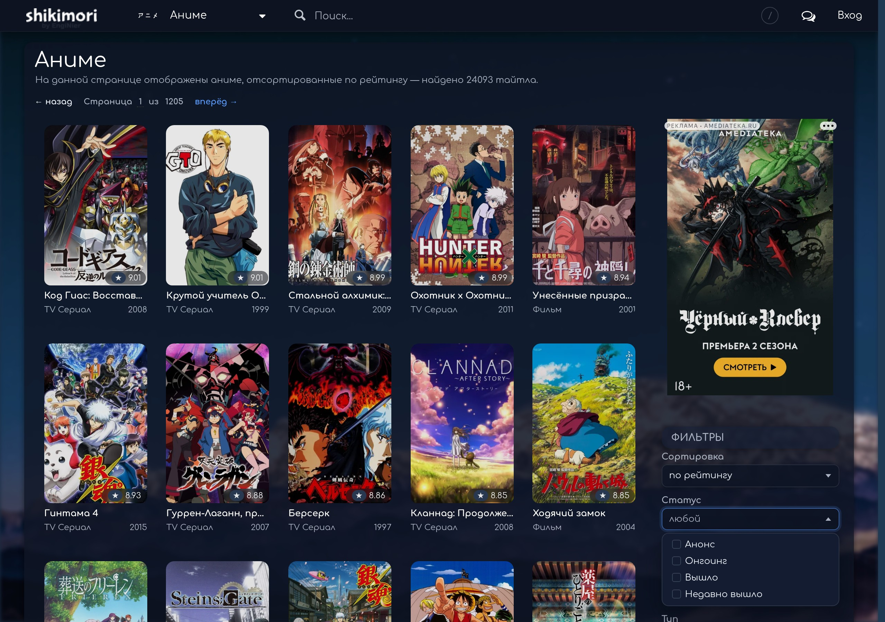
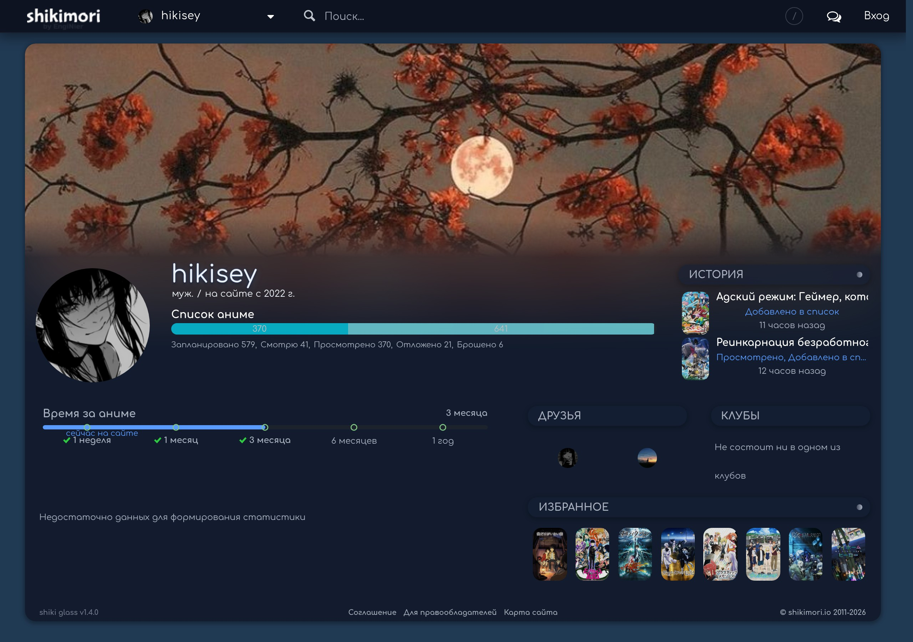

<div align="center">

# shiki glass

Тёмная стеклянная тема для [Шикимори](https://shikimori.io) и [shikimori.rip](https://shikimori.rip)

[](https://github.com/Hikisey/shikimori-theme/releases)


[Установка](#установка) · [Цвета и обои](#цвета-обои-и-баннер) · [Если что-то не так](#если-что-то-пошло-не-так) · [Обновления](https://github.com/Hikisey/shikimori-theme/releases)

<table>
  <tr>
    <td valign="top"></td>
    <td valign="top" width="240"></td>
  </tr>
</table>

</div>

Мягкое стекло, графит и алый акцент. Одни и те же файлы работают на обоих сайтах, на компьютере и на телефоне. Цвет акцента, обои и баннер профиля меняются парой строк.

<table>
  <tr>
    <td width="33%"><p align="center"><sub>Главная</sub></p></td>
    <td width="33%"><p align="center"><sub>Каталог</sub></p></td>
    <td width="33%"><p align="center"><sub>Профиль</sub></p></td>
  </tr>
</table>

## Установка

1. На Шикимори откройте профиль → **Настройки** → **Внешний вид сайта**.
2. Откройте [site.css](https://github.com/Hikisey/shikimori-theme/blob/v1.7.5/site.css), скопируйте его **целиком** (кнопка копирования справа над кодом) и вставьте в поле стиля вместо того, что там было.
3. Нажмите **Сохранить** и обновите страницу с очисткой кеша: <kbd>Ctrl</kbd>+<kbd>Shift</kbd>+<kbd>R</kbd>.

В site.css лежат строки подключения темы и блок настроек: обои, баннер профиля и цвета.

> [!TIP]
> **Обновление.** Когда выйдет новая версия, замените в четырёх строках `@import` номер `v1.7.5` на новый со страницы [Releases](https://github.com/Hikisey/shikimori-theme/releases). Свои цвета и обои можно не трогать.

> [!NOTE]
> Частей четыре, потому что Шикимори не принимает файл больше ~230 КБ, а вся тема весит около 600 КБ.

## Цвета, обои и баннер

По умолчанию тема алая. Чтобы перекрасить её, поменяйте значения в блоке «Палитра» в вашем стиле (он пришёл вместе с site.css). Цвет пишется тремя числами через запятую, например `232, 108, 108`. Обычно хватает одного `--accent`: кнопки, ссылки и подсветка перекрасятся сами.

Первые две строки блока (`@media` и `html:root`) не трогайте: без них на телефоне цвета могут не примениться.

| Переменная | Что меняет |
| --- | --- |
| `--accent` | главный цвет: ссылки, кнопки, ник, подсветка |
| `--link` | только ссылки, если нужен отдельный цвет |
| `--bg-image` / `--bg-image-mobile` | обои на компьютере / на телефоне |
| `--bg-color` / `--bg-color-mobile` | цвет под обоями, пока они загружаются |
| `--bg-dim` | затемнение обоев: `0` яркие, `1` совсем тёмные |
| `--bg-blur` / `--bg-blur-mobile` | размытие обоев на компьютере / на телефоне |
| `--profile-banner` | картинка-баннер над профилем |
| `--profile-banner-height` | высота баннера на компьютере |
| `--glass` | цвет стеклянных блоков, меню и окон |
| `--glass-blur` | сила размытия под стеклом |
| `--text` | основной текст |
| `--text-2` | подписи и второстепенный текст |

<details>
<summary><b>Пример: синий акцент и другие обои</b></summary>
<br>

Замените этими строками соответствующие значения в блоке «Палитра» или вставьте блок в самый конец стиля. Слева тема как есть, справа с этим примером.

```css
@media screen and (min-width: 1px) {
  html:root {
    --accent: 90, 155, 255;
    --link: var(--accent);

    --bg-image: url("//cdn.jsdelivr.net/gh/Hikisey/shikimori-theme/bg_blue.webp");
    --bg-image-mobile: url("//cdn.jsdelivr.net/gh/Hikisey/shikimori-theme/bg_blue_m.webp");
    --bg-color: 33, 58, 84;
    --bg-color-mobile: 39, 61, 87;
    --bg-dim: .35;
    --bg-blur: 3px;

    --glass: 22, 32, 54;
    --glass-blur: 8px;

    --text: 236, 240, 247;
    --text-2: 170, 178, 192;
  }
}
```


</details>

> [!WARNING]
> В ссылке на свою картинку не должно быть символа `@`, иначе Шикимори её не покажет.

## Если что-то пошло не так

<details>
<summary><b>Тема не загрузилась или осталась старая</b></summary>
<br>

Обновите страницу с очисткой кеша (<kbd>Ctrl</kbd>+<kbd>Shift</kbd>+<kbd>R</kbd>). Если Шикимори пишет «Не удалось импортировать», откройте [сброс кеша стилей](https://shikimori.io/tests/reset_styles_cache) (на rip — [shikimori.rip/tests/reset_styles_cache](https://shikimori.rip/tests/reset_styles_cache)), вставьте туда ссылку из сообщения, сохраните стиль ещё раз и обновите страницу.

Если в левом нижнем углу видна красная надпись «shiki glass: не загрузилась часть N», Шикимори не скачал эту часть (ошибку он помнит 8 часов). Сбросьте кеш для ссылки `part_0N.css` из вашего стиля так же, как выше. Надпись есть только в site.css начиная с v1.7.5.
</details>

<details>
<summary><b>На телефоне цвета не изменились, а на компьютере всё в порядке</b></summary>
<br>

Проверьте, что вокруг ваших настроек остались строки `@media screen and (min-width: 1px)` и `html:root`, как в примере.
</details>

<details>
<summary><b>Свои обои или баннер не видны</b></summary>
<br>

Уберите из ссылки символ `@` и сохраните стиль снова.
</details>

## Как устроены файлы

- `site.css` — то, что вы вставляете в «Внешний вид сайта»: строки `@import` и блок «Палитра» с пояснениями.
- `css/part_01.css` … `part_04.css` — сама тема. Они собраны из модулей в папке [`src/`](src) без комментариев: Шикимори всё равно вырезает комментарии при загрузке, а без них в каждый файл помещается больше правил. Файлы при этом не сжаты: обычные отступы и переносы.
- `src/` — исходники с подробными комментариями, порядок модулей задаёт `src/manifest.txt`. Если хотите поправить тему под себя, читайте и правьте их, а не `css/`.
- Устройство темы, ограничения Шикимори и история версий — в [docs/ARCHITECTURE.md](docs/ARCHITECTURE.md), памятка для правок — в [AGENTS.md](AGENTS.md).

Палитра работает так: всё «красное» считается из одного `--accent`, тёмные оттенки меню и окон — из `--glass`, светлые — из `--text` (в Chrome 119+, Safari 16.4+, Firefox 128+; в старых браузерах остаются оттенки по умолчанию). Старые имена переменных из прошлых тем (`--bright-color`, `--block-color`, `--page-bg` и т. п.) тоже понимаются.

На iPhone сила размытия стекла фиксированная: Safari плохо понимает `-webkit-backdrop-filter` с переменной, поэтому `--glass-blur` меняет размытие только в Chrome и Firefox.

## Благодарности

Основа темы: [E-design](https://github.com/ed-main) от [ed-main](https://github.com/ed-main).

Обои из синего примера: [Kanchenjunga South Peak](https://commons.wikimedia.org/wiki/File:Kanchenjunga_South_Peak_%28Unsplash%29.jpg) (Mukesh Jain, Unsplash, [CC0](https://creativecommons.org/publicdomain/zero/1.0/)).
