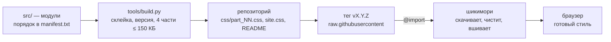

# hikisey theme — архитектура проекта

> подробная карта темы для [шикимори](https://shikimori.one), актуально для **v1.3.6**: где что лежит, как шикимори загружает и чистит css, как устроена палитра, как выходят релизы и чем отличаются телефон и пк.

## содержание

- [коротко](#коротко)
- [репозиторий: файлы и папки](#репозиторий-файлы-и-папки)
- [модули src/](#модули-src)
- [сборка и проверки](#сборка-и-проверки)
- [почему тема разбита на части (v1.2.23)](#почему-тема-разбита-на-части-v1223)
- [палитра](#палитра)
- [как считаются оттенки](#как-считаются-оттенки)
- [как шикимори загружает и фильтрует css](#как-шикимори-загружает-и-фильтрует-css)
- [site.css: установка и настройка](#sitecss-установка-и-настройка)
- [выпуск релиза](#выпуск-релиза)
- [телефон и пк](#телефон-и-пк)
- [заметные фичи](#заметные-фичи)
- [известные ограничения](#известные-ограничения)
- [история версий](#история-версий)

краткая памятка для правок — в [AGENTS.md](../AGENTS.md), установка — в [README](../README.md).

## коротко

| | |
|---|---|
| **репозиторий** | github.com/Hikisey/shikimori-theme |
| **текущая версия** | v1.3.6 (подвал сайта: «hikisey theme v1.3.6»), 4 части по ≤ 150 КБ |
| **основа** | тема E-design от ed-main, переписанная и расширенная |
| **объём** | 35 модулей в `src/`, около 19 700 строк и 567 КБ без сжатия (с комментариями); выпускаются 4 частями `css/part_NN.css` по ≤ 150 КБ |
| **подключение** | по строке `@import` на каждую часть (с тегом версии) + блок палитры в «Внешнем виде сайта» |
| **без js** | всё сделано на чистом css: шикимори не пускает скрипты в стили |



## репозиторий: файлы и папки

| путь | зачем |
|---|---|
| `src/` | исходники: 35 модулей по слоям (таблица ниже) и `manifest.txt` с порядком каскада |
| `css/part_NN.css` | то, что подключается: модули подряд, разложенные целиком по 4 частям ≤ 150 КБ. руками не правятся |
| `tools/build.py` | сборка `src/` → `css/`, подстановка версии в подвал, печать строк `@import` |
| `tools/quick_check.py`, `tools/shot.js` | быстрая проверка: сборка во временную папку, эмуляция фильтра, жёсткие правила, скриншот сохранённой страницы |
| `tools/shiki_compile.py` | эмуляция фильтра шикимори (SanitizeEvilCss + camo): что останется от css после загрузки |
| `tools/shiki_url_check.py` | проверка, что после camo ни одна ссылка не «съела» соседний код |
| `site.css` | готовый стиль для вставки: 2 сторонних импорта, импорты частей темы с тегом, палитра с комментариями, дополнительные блоки |
| `README.md` | коротко для пользователей: установка, палитра, пример |
| `bg.webp`, `bg_m.webp` | обои для пк (около 750 КБ) и лёгкие для телефона (900×1440, около 180 КБ) |
| `docs/screenshot.jpg`, `docs/example_override.jpg` | скриншоты для README |
| `docs/ARCHITECTURE.md` | этот документ |
| `AGENTS.md` | короткая навигация и жёсткие правила для правок (для ai-ассистентов и людей) |

## модули src/

слои идут в таком порядке: токены → база → каркас → компоненты → страницы → наборы «О себе» → подвал → поздние правила. внутри слоя порядок модулей подобран так, чтобы как можно меньше правил пришлось оставлять в `overrides/late.css`.

| модуль (в порядке каскада) | строк | КБ | что внутри |
|---|---|---|---|
| `tokens/palette.css` | 214 | 16.4 | палитра: акцент, фон, стекло, текст и производные оттенки (переопределяется блоком «Палитра» в site.css) |
| `tokens/components.css` | 63 | 2.9 | токены компонентов: --plate-*, --heading-*, --btn-*, --arrow-*, --card-*, --tip-*, --tab-*, --field-*, --ease-* (см. «токены компонентов») |
| `base/fonts.css` | 54 | 2.1 | @font-face: шрифты и иконочный шрифт |
| `base/base.css` | 585 | 13.3 | база: ссылки, текст, таблицы, полосы прокрутки, служебные мелочи |
| `base/animations.css` | 301 | 4.8 | все @keyframes темы |
| `base/colors.css` | 46 | 1.2 | цветовые классы bb-кодов и подсветки (.red, .green, …) |
| `layout/header.css` | 459 | 14.2 | верхняя панель .l-top_menu-v2, выпадающие меню, глобальный поиск |
| `layout/page.css` | 959 | 26.3 | каркас страницы: html/body, обои, .l-page, колонки и сетки .cc/.c-column |
| `components/badges.css` | 111 | 2.5 | статусы и метки: *_status_tag, *_marker, .b-tag |
| `components/carousels.css` | 206 | 6.5 | ленты, стрелки, пагинация, кнопка «наверх»; стрелки лент (::scroll-button) |
| `components/tooltips.css` | 174 | 4.5 | подсказки .tipsy, .b-tooltipped, всплывающие карточки |
| `components/headings.css` | 236 | 5.7 | заголовки .headline / .subheadline / .midheadline |
| `components/users.css` | 135 | 2.7 | пользователи и аватары: .b-user, .b-user16, .b-menu-line |
| `components/buttons.css` | 256 | 6.2 | кнопки .b-link_button, .b-button, button, кнопки действий |
| `components/stats.css` | 62 | 1.7 | полоски-шкалы .bar |
| `components/tabs.css` | 599 | 15.0 | вкладки и переключатели: .b-options-floated, .b-list_switchers, use-tabs |
| `components/plates.css` | 18 | 0.4 | стеклянные плашки .block |
| `components/cards.css` | 298 | 7.3 | карточки аниме/манги .b-catalog_entry, обложки .image-decor |
| `components/editor.css` | 889 | 21.2 | комментарии, редактор .b-shiki_editor, спойлеры, цитаты, код |
| `components/modals.css` | 50 | 1.2 | окна: просмотр картинок (mfp), bulma-модалки, обратная связь |
| `components/forms.css` | 538 | 15.7 | поля, select и мультиселект фильтров (.c-ms), галочки, @starting-style выезда списков |
| `pages/clubs.css` | 244 | 6.1 | клубы |
| `pages/profile.css` | 1689 | 51.0 | профиль: шапка, баннер, история, списки-статистика, совместимость, друзья |
| `pages/anime.css` | 1105 | 35.1 | страница аниме/манги/персонажа: описание, постер, кадры и видео, плеер, «добавить в список» |
| `pages/settings.css` | 260 | 8.3 | настройки профиля и аккаунта, сервисы входа |
| `pages/catalog.css` | 495 | 17.7 | каталог: фильтры слева, коллекции, поиск |
| `pages/messages.css` | 573 | 15.1 | почта, диалоги, уведомления |
| `pages/lists.css` | 671 | 24.2 | списки аниме/манги пользователя, сравнение списков |
| `pages/achievements.css` | 1228 | 37.4 | ачивки: страница и блок в профиле |
| `pages/contests.css` | 152 | 3.9 | турниры |
| `pages/forum.css` | 628 | 16.0 | форум, топики, отзывы и рецензии, опросы |
| `pages/dashboard.css` | 450 | 11.7 | главная: новости, темы дня, «мой список» |
| `kits/custom-posters.css` | 70 | 2.3 | свои постеры персонажей и точечные правки отдельных профилей |
| `kits/about-kits.css` | 1357 | 32.6 | наборы для «О себе»: Animes_Mangas, Ssylki, Razmer, k-0-1 и т. п. (не удалять) |
| `layout/footer.css` | 70 | 1.4 | подвал и подпись «hikisey theme vX.Y.Z» |
| `overrides/late.css` | 3741 | 104.1 | правила, которые обязаны идти после страниц: они перебивают правила других модулей с тем же весом селектора. у каждого помечен модуль, где ему место |
| **всего** | **18986** | **538.7** | |

**телефон рядом с модулем.** в конце каждого модуля — раздел `/* ----- телефон и узкие экраны ----- */`: его правила для ширины ≤1023 и сенсорных экранов (`hover: none`, `pointer: coarse`). несколько телефонных правил остались в основной части модуля внутри своего `@media` — их нельзя опустить ниже соседей.

**`overrides/late.css`.** 450 правил (было 507 после разбиения на модули), которые перебивают правило из модуля, стоящего в манифесте позже, при том же весе селектора и тех же свойствах. если перенести такое правило «домой», оно встанет раньше перебиваемого и проиграет. поэтому они собраны в конце, и у каждого помечено `/* из <модуль> */`. по домам: profile 51, tabs 44, achievements 29, about-kits 29, page 28, cards 28, header 26, settings 21, anime 20, forum 19, editor 19, dashboard 17, остальные меньше. около 240 из них не совпали ни с одним элементом сохранённых страниц, но их классы есть в разметке или скриптах шикимори (окна, редактирование, состояния после входа), поэтому они оставлены. 60 правил уже вернулись домой: их селектору добавлен повтор первого класса (`.x.x`), этого хватает, чтобы перебить правило из модуля ниже, и вес не стал больше, чем у правил, которые должны перебивать их самих. остальные переедут домой при объединении компонентов: селектор получит больший вес или правило сольётся с тем, которое оно перебивает.

**токены компонентов (`tokens/components.css`, шаг 2 рефакторинга).** одинаковые элементы берут значения из общих переменных на `:root`, поэтому вид плашек, заголовков, кнопок, стрелок, карточек и плавность наведения меняются в одном месте (или в site.css внутри `html:root { … }`). заменялись только значения, в точности равные токену, поэтому вычисленные стили не изменились (проверено на всех сохранённых страницах).

| группа | токены | где используются |
|---|---|---|
| плашки | `--plate-bg`, `--plate-bg-strong`, `--plate-shadow`, `--plate-shadow-soft`, `--plate-shadow-strong`, `--plate-blur`, `--plate-radius`, `--plate-radius-lg` | 191 объявление во всех модулях: стеклянный фон, тень, скругление 10/14px, `backdrop-filter` |
| заголовки | `--heading-radius`, `--heading-height`, `--heading-text`, `--heading-link`, `--heading-dot`, `--heading-dot-hover` | .headline / .midheadline / .subheadline |
| кнопки | `--btn-bg`, `--btn-bg-hover`, `--btn-text` | .b-link_button, .b-button и кнопки того же цвета |
| стрелки лент | `--arrow-size`, `--arrow-bg`, `--arrow-bg-hover`, `--arrow-border`, `--arrow-shadow`, `--arrow-icon-size`, `--arrow-inset` | `::scroll-button` лент, общий блок в `components/carousels.css` |
| карточки | `--card-radius`, `--card-image-radius`, `--card-lift`, `--card-hover-shadow`, `--card-zoom` | .b-catalog_entry |
| подсказки | `--tip-bg`, `--tip-radius`, `--tip-shadow` | .tipsy |
| вкладки | `--tab-active`, `--tab-tap-ease` | components/tabs, анимация нажатия переключателей |
| поля | `--field-text`, `--drop-shift` | components/forms: текст полей, сдвиг выпадающих списков |
| плавность | `--ease-out`, `--ease-fast`, `--ease-base` | `transition`/`animation`, в том числе внутри списков `transition` (`background-color var(--ease-fast), …`) |

в `-webkit-backdrop-filter` токены не используются: там всегда фиксированное значение (у Safari баг с переменными).

**очистка (v1.2.24).** удалялось только то, что точно не работает на нынешнем сайте или ни на что не влияет:
- правила для классов, которых нет ни на сохранённых страницах, ни в css и скриптах шикимори, ни в его старом исходном коде, и которые относятся к убранным разделам: старый видеоплеер (`.b-video_variant`, `.b-video_player`, `.cc-player_controls`, `.c-anime_video_episodes`…), виджет VK (`.wcommunity_*`), старое верхнее меню `.l-top_menu` — 87 правил и 12 селекторов из списков. классы, которые просто не встретились (наборы «О себе», `use-tabs`, `custom-panel`, Vue-компоненты, окна), не удалялись;
- объявления, которые всегда перебивает более позднее правило с теми же селекторами и не более узкими медиазапросами (с учётом сокращений вроде `background`/`margin` и `!important`; запасные значения для старых браузеров не трогались) — 35, из них 4 правила целиком;
- повторы селектора внутри одного списка — 25;
- `!important`, если это свойство больше нигде не задаётся ни темой, ни шикимори для тех же элементов, — 1. остальные `!important` перебивают стили шикимори или встроенные стили из скриптов, доказать их ненужность нельзя.

### как модули получены из v1.2.23 (без изменений внешнего вида)

1. весь каскад v1.2.23 (файлы 1 → 2 → 3 → 4mob) разобран на 2 793 элемента: правила, `@font-face`, `@keyframes`, `@starting-style`; вложенные `@media`/`@supports` сохранены как обёртки каждого правила.
2. каждому правилу назначен модуль по селектору: сначала наборы и страницы, затем каркас и компоненты, остальное — `base`.
3. для каждой пары правил, где порядок важен, записано ограничение «A раньше B». порядок важен, если у правил есть общее свойство (с учётом сокращений вроде `margin` и `margin-top`), одинаковая важность (`!important`), равный вес селектора, совместимые медиазапросы и один и тот же псевдоэлемент. и ещё одно условие: селекторы могут попасть в один элемент. это проверялось по 79 209 элементам 36 сохранённых страниц, а для селекторов, которых на этих страницах нет, — по общему классу, тегу или атрибуту в правой части селектора. получилось 3 326 ограничений.
4. если модуль правила стоит в манифесте раньше, чем того, после которого правило обязано идти, оно уходит в `overrides/late.css`; телефонное правило в такой ситуации остаётся в основной части модуля.
5. проверка: вычисленные стили всех элементов (а также `::before` и `::after`) на 30 страницах пк (1280) и 15 телефонных (390): обычное состояние и состояние наведения, фокуса и нажатия (`:hover`/`:focus`/`:active` подменялись классами на всех элементах). плюс ширины 820 и 1100 на 11 страницах. результат — 0 отличий от v1.2.23. после фильтра шикимори все части парсятся без ошибок.

## сборка и проверки

- **сборка:** `python3 tools/build.py [--version X.Y.Z]` — склейка модулей по `src/manifest.txt`, раскладка целых модулей по `css/part_NN.css` (≤ 150 000 байт, жёсткий предел 160 КБ и 4 части), версия в `layout/footer.css`, в конце строки `@import`. модуль, которого нет в манифесте, в сборку не попадёт — скрипт предупредит.
- **быстрая проверка (по умолчанию для мелких правок):** `python3 tools/quick_check.py --page <сохранённая страница> [--phone]` — сборка во временную папку, эмуляция фильтра шикимори с проверкой, что не пропало ни одно правило, проверка ссылок после camo, жёсткие правила (behavior, `@view-transition`, обратные слэши, размер частей), счётчик `:hover` вне медиазапроса, скриншот страницы с темой и палитрой из `site.css`.
- **полная регрессия (перед релизом):** сравнение вычисленных стилей и скриншотов с прошлым тегом на пк и телефоне (инструменты у автора).

## палитра

все цвета темы пишутся rgb-тройкой «R, G, B», поэтому работает `rgba(var(--x), .5)`. старые имена из прошлых версий понимаются как запасные.

| переменная | по умолчанию | что перекрашивает |
|---|---|---|
| `--accent` | 232, 108, 108 | ссылки, значки, подсветка, активные вкладки, полоски; из него — кнопки, ник, наведение |
| `--link` | = accent | только ссылки |
| `--bg-image` / `-mobile` | обои темы | обои пк и телефона |
| `--bg-color` / `-mobile` | 28,30,33 / 167,148,145 (в site.css: 151,128,128 / 167,148,145) | цвет под обоями, пока они грузятся |
| `--bg-zoom` | 1.08 | приближение обоев на пк |
| `--bg-blur` / `-mobile` | 0px / 1.5px | размытие обоев |
| `--bg-dim` | .5 | затемнение обоев (`body:after`) |
| `--bg-brightness-mobile` | .9 | яркость обоев на телефоне |
| `--profile-banner*` | none, 300px, 170px, center, .5 | баннер профиля: картинка, высота пк/телефон, позиция, свечение |
| `--glass` | 30, 34, 42 | стекло блоков; из него — панель, меню, окна, тени |
| `--glass-light` | 255, 255, 255 | рамки и блики на стекле |
| `--glass-blur` | 5px | размытие под стеклом (Chrome, Firefox) |
| `--text` | 236, 240, 247 | основной текст |
| `--text-2` | 170, 178, 192 | подписи, второстепенный текст; из него — текст полей |
| `--text-3` | 140, 148, 160 | даты, счётчики |
| `--text-strong` | 255, 255, 255 | заголовки карточек, текст на кнопках |
| оценки и шкалы | отдельная группа | `--*-rating`, `--time-filled/empty`, `--anime-*`, `--manga-*` |

около 470 цветов намеренно оставлены числами: статусы списков и меток, золотая страница ачивок, цвета bb-кодов, подсветка кода, бренды vk, ники отдельных людей, радуги и цвета наборов «О себе», маски.

## как считаются оттенки

каждый производный оттенок задан дважды: сначала числом (старые браузеры), потом формулой относительного цвета, которая при значениях по умолчанию даёт ровно то же число.

```css
--accent-dim: rgb(178, 58, 64);   /* запасное значение */
@supports (color: rgb(from red r g b)) {
  html:root {
    --accent-dim: rgb(from rgb(var(--accent)) calc(r * 178 / 232) calc(g * 58 / 108) calc(b * 64 / 108));
  }
}
/* прозрачность — через color-mix */
background: color-mix(in srgb, var(--glass-deep) 55%, transparent);
```

| оттенок | из чего | где |
|---|---|---|
| `--accent-dim` | accent | кнопки, подложка ника |
| `--accent-hover` | accent | кнопки под курсором |
| `--link-hover` | link (к белому) | ссылки под курсором |
| `--glass-deep` | glass | меню, затемнение обоев, стеклянные плашки телефона |
| `--glass-bar` / `-bar-hover` | glass | верхняя панель |
| `--glass-popup` | glass | выпадающие списки, подсказки |
| `--glass-active` | glass | нажатые и выбранные элементы |
| `--glass-shadow` | glass | тени |
| `--text-input` | text-2 | текст в полях |
| `--tone-xxxxxx` (59 шт.) | glass / text / accent | серые и светлые служебные цвета |

перед выпуском v1.2.20 все 1 260 изменённых деклараций сравнивались по вычисленным значениям в Chrome и WebKit, скриншоты при значениях по умолчанию совпали попиксельно (кроме номера версии).

## как шикимори загружает и фильтрует css

1. **вырезает @import** — из «Внешнего вида сайта» достаются все `@import url(...)`, остальное — пользовательский css
2. **скачивает на своём сервере** — каждый адрес качается сервером шикимори (до 2 попыток, таймаут около 5 с), браузер github не видит
3. **кеширует на 8 часов** — ключ кеша — точный адрес; пустой ответ после неудачи тоже может пролежать в кеше 8 часов
4. **чистит (SanitizeEvilCss)** — удаляет комментарии, опасные слова, обратные слэши и лишние data:-картинки
5. **переписывает ссылки (camo)** — картинки идут через прокси шикимори
6. **склеивает** — импорты вшиваются первыми; css без `@media` оборачивается в `@media only screen and (min-width: 1024px)`

| ловушка | что происходит | как обходим |
|---|---|---|
| слово behavior | удаляется везде (`scroll-behavior` → `scroll-`) | плавной прокрутки нет; слово не используем |
| обратный слэш | `\` + буква/цифра удаляется вне строк `content:` | никаких экранирований, кроме иконок в `content` |
| camo и `;` | регулярка ссылки «съедает» `)` и `}` после `url(...)`, если нет `;` | всегда `url(...);` перед `}`, без минификации |
| символ `@` в ссылке | вырезается | ссылки на картинки без `@` |
| data:-uri | остаются только base64 `image/svg+xml\|png\|jpeg\|jpg\|gif` | галочка, play и т. п. — base64 svg |
| `@media`-обёртка | css без `@media` уходит только на ширину ≥1024 | палитра всегда в `@media (min-width: 1px)` |
| другие слова | eval, cookie, window, parent, this, script, expression… | не встречаются в коде и комментариях |

> **ℹ️ ссылки с `//` тоже идут через прокси.** по исходникам шикимори (`Styles::Compile#camo_images` → `generate_camo_url`) регулярка находит в css и `https://…`, и `//…`. ссылке с `//` добавляется протокол, после чего она так же переписывается на camo-прокси шикимори. мимо прокси проходят только адреса доменов самого шикимори (они отдаются без протокола); адреса из списка запрещённых доменов заменяются прозрачной картинкой. в старом коде шикимори прямые ссылки на `//` и `https://` действительно пропускались без прокси, но этот код закомментирован: «прямые ссылки раскрывают ip пользователей». значит, `//` в ссылках на обои ничего не меняет — работает так же, как `https://`.

## site.css: установка и настройка

1. **открыть site.css нужного тега** — raw.githubusercontent.com/Hikisey/shikimori-theme/v1.3.6/site.css
2. **скопировать целиком** — сначала 2 сторонних импорта (тёмный CodeMirror, свои постеры), потом 4 импорта темы (все с raw.githubusercontent)
3. **вставить в «Внешний вид сайта»** — заменить всё старое, сохранить, обновить страницу с Ctrl+Shift+R
4. **менять только блок «Палитра»** — `@media screen and (min-width: 1px) { html:root { … } }`, обёртку не удалять

```css
@import url("https://raw.githubusercontent.com/Hikisey/shikimori-theme/v1.3.6/css/part_01.css");
@import url("https://raw.githubusercontent.com/Hikisey/shikimori-theme/v1.3.6/css/part_02.css");
@import url("https://raw.githubusercontent.com/Hikisey/shikimori-theme/v1.3.6/css/part_03.css");
@import url("https://raw.githubusercontent.com/Hikisey/shikimori-theme/v1.3.6/css/part_04.css");
```

`html:root` в палитре нужен, чтобы вес селектора совпал с палитрой темы и пользовательский блок, идущий позже, побеждал.

## выпуск релиза

1. **правка исходников** — модули `src/`, никогда сами файлы в `css/`
2. **сборка** — `python3 tools/build.py --version X.Y.Z` — версия попадает в `--theme-version` и в подвал, `css/` пересобирается 4 частями ≤ 150 КБ (build.py остановится, если частей больше 4 или часть больше 160 КБ)
3. **проверки** — `tools/quick_check.py` без ошибок (фильтр шикимори, ссылки, behavior, `@view-transition`, размеры) и полная регрессия
4. **скриншоты до/после** — пк 1280 в Chrome, iPhone 13 в WebKit и телефон в Chrome
5. **версия в site.css и README** — замена старого тега на новый
6. **commit, push, тег, GitHub release** — релиз с описанием на русском
7. **проверка raw-адресов** — все части отдают 200 и побайтно совпадают с репозиторием; если число частей изменилось, обновить строки в `site.css` и README

- теги, а не main: шикимори кеширует каждый адрес на 8 часов, а новый тег — новый адрес, который скачается сразу и не изменится потом
- main только для разработки; в v1.2 пробовали следить за main и сбрасывать кеш `?v=2`, `?v=3` — от этого отказались
- без минификации: в v1.2.9 сжатие склеило `url("…")}`, camo съел скобку и следующие правила пропали; v1.2.10 вернул читаемый вид
- у тега v1.2.4 нет GitHub-релиза; опубликованные теги не переносятся

## пределы импорта шикимори (v1.3.5)

| предел | откуда известно |
|---|---|
| **не больше ~6 `@import` всего** (2 из них — css-club, значит частей темы не больше 4) | v1.3.3: части 5–8 из 8 с raw.githubusercontent «не удалось импортировать», 1–4 подключились; v1.3.4: те же 5–8 с jsDelivr — снова ошибка. дело не в хосте, а в номере импорта |
| **файл не больше ~230 КБ** | v1.2.20: 4 файла, самый большой 225 КБ — подключались; v1.2.21: файл 231 КБ — нет (таблица ниже) |

- **решение (v1.3.5).** тема собирается ровно в 4 части ≤ 150 КБ (запас до ~230 КБ). `tools/build.py` раскладывает модули целиком в порядке манифеста и останавливает сборку, если часть больше 160 КБ или частей больше 4. все части — с raw.githubusercontent с тегом.
- **история ошибки.** в v1.2.23–v1.3.4 тема шла 7–8 частями по ≤ 80 КБ. пока частей было 7, ошибки не замечали (импорты 7–9 тоже могли не грузиться — неполная тема выглядела почти нормально); в v1.3.4 подумали на ограничение GitHub и перенесли 5–8 на jsDelivr — не помогло.
- если понадобится больше css, чем 4 × 150 КБ, сначала поднимать предел части (до ~200 КБ, проверив импорт), а не число частей.

## почему тема разбита на части (v1.2.23)

на v1.2.21–v1.2.22 шикимори писал «Не удалось импортировать» про `main_code_4mob.css`, а остальные три файла (около 100 КБ каждый) подключались.

| версия | размер 4mob | результат |
|---|---|---|
| v1.2.20 | 225 317 Б | подключался |
| v1.2.21 | 231 438 Б | не подключился |
| v1.2.22 | 233 749 Б | не подключился |

- **что известно.** в старом коде шикимори (Rails) файл качается сервером: таймаут ответа 5 с, соединения 2 с, ответ кроме «200 + UTF-8» превращается в пустую строку и кешируется на 8 часов; пустой импорт и есть «не удалось импортировать». сам файл валиден: UTF-8, парсится, эмуляция фильтра ничего лишнего не вырезает. сайт сейчас работает на новом фронтенде, и точные лимиты нового загрузчика снаружи не видны.
- **вывод.** отказ совпал с ростом файла за отметку около 225–231 КБ, а файлы около 100 КБ грузятся стабильно. скорее всего, у загрузчика есть предел размера ответа или времени загрузки, и большой файл в него не укладывается. содержимое тут ни при чём: те же правила, нарезанные на части, после фильтра дают байт-в-байт тот же css.
- **решение тогда (v1.2.23).** правила резались на части не больше 80 КБ; с v1.3.5 — 4 части ≤ 150 КБ, см. «пределы импорта шикимори» выше.
- **почему не jsDelivr.** по старому коду адрес `cdn.jsdelivr.net/gh/Hikisey/shikimori-theme@v1.2.23/css/…` допустим (`@` в адресе импорта не вырезается, обои с jsDelivr уже идут через camo). но ограничения нового загрузчика по хостам проверить снаружи нельзя, а raw.githubusercontent с тегом проверен на всех прошлых версиях. поэтому основной путь — raw, а jsDelivr — запасной: те же пути, `@vX.Y.Z` вместо `/vX.Y.Z`. на jsDelivr ограничения размера не помогли бы — если дело в размере, большой файл не пройдёт и оттуда.
- **после выпуска** все адреса открываются один раз (прогрев кеша GitHub). если неудача уже закешировалась у шикимори, адрес из сообщения сбрасывается на `shikimori.io/tests/reset_styles_cache`.

## телефон и пк

| что | как |
|---|---|
| брейкпоинты | пк ≥1024 (баннер и ачивки ≥1200), планшет 768–1023, телефон ≤767, мелкие экраны 650/540/480/420/350 |
| правки только для телефона | только внутри `@media screen and (max-width: 767px)` |
| наведение | любой `:hover` только в `@media (hover: hover) and (pointer: fine)`, на сенсорах — короткий отклик нажатия |
| списки | на сенсорных экранах select — системный (колёсико iOS); на пк — общий компонент поля с анимацией |
| стекло | на телефоне плашки с `backdrop-filter`; для Safari сила размытия записана числом |
| обои | отдельный лёгкий кадр `bg_m.webp`, лёгкое размытие 1.5px и яркость .9 |
| фильтры | карточка по центру экрана, плотное матовое стекло, списки раскрываются через grid-rows 0fr↔1fr |

## заметные фичи

| фича | версия | как сделано |
|---|---|---|
| ленты кадров и видео | v1.2.16–17 | горизонтальная прокрутка со scroll-snap, 16:9, play-кнопка из base64 svg, заголовок и лента — одна стеклянная панель |
| стрелки лент | v1.2.17 | `::scroll-button(*)` (Chromium 135+), только пк с мышью, под `@supports selector(...)` |
| логотипы студий | v1.2.18–19 | скругление, контур 1px через drop-shadow; чёрные прозрачные логотипы (id 11, 44, 858) — белым силуэтом; подъём на 3px |
| иконки сайтов | v1.2.18 | светлый круглый бейдж 20px под favicon в «На других сайтах» |
| галочки | v1.2.13–15 | круг 18px по середине строчных букв, svg-галочка растёт и сжимается |
| фильтры | v1.2–1.2.21 | общий компонент полей, плавное раскрытие, карточка на телефоне |
| баннер профиля | v1.0, v1.2.21 | пк: 300px над шапкой со свечением; телефон: 170px сверху, аватар на нижнем крае |
| палитра | v1.2.20 | все цвета на переменных, 4 группы |

## известные ограничения

- нет плавной прокрутки по стрелкам: шикимори вырезает слово behavior, обход через экранирование тоже вырезается
- в режиме списка у шикимори в разметке нет постеров, css их не добавит
- Safari: `-webkit-backdrop-filter` не понимает `var()`, поэтому `--glass-blur` действует только в Chrome и Firefox
- до Chrome 119 и Safari 16.4 производные оттенки не пересчитываются, остаются цветами по умолчанию
- режим блокировки iPhone (Lockdown Mode) не отключает backdrop-filter, но блокирует часть веб-шрифтов и экспериментальные функции
- стрелки `::scroll-button` есть только в Chromium 135+, в остальных браузерах лента листается свайпом и колесом
- старые имена палитры для оттенков (`--buttoms-color`, `--menu-back`, `--popup-color`…) больше не задаются отдельно

## история версий

| версия | что изменилось |
|---|---|
| v1.0–v1.1 | своя тема на основе ed-main: обои, баннер, общий компонент полей, анимации списков, яркие иконки сервисов |
| v1.2 | облегчение кода, фиксы select, телефон: размытые обои, карточка фильтров, плитки действий |
| v1.2.1 | жидкое стекло фильтров, поля 16px, профиль карточками |
| v1.2.2 | строка «Время за аниме» над шкалой |
| v1.2.3 | читаемость на телефоне: тень текста, стекло под заголовками и блоками |
| v1.2.4 | обои снова с лёгким размытием 1.5px |
| v1.2.5 | мягче стекло на телефоне |
| v1.2.6 | плавное сворачивание списков фильтра |
| v1.2.7 | iPhone: системный select, без клавиатуры в коротких списках |
| v1.2.8 | hover только для мыши, отклик нажатия на сенсорах |
| v1.2.9 | сжатие 4mob — сломало правила после url (camo) |
| v1.2.10 | возврат к читаемому виду |
| v1.2.11–12 | список аниме на пк: стеклянные заголовки и поиск |
| v1.2.13–15 | галочки по тексту, подпись темы в подвале, svg-галочка по центру |
| v1.2.16 | кадры и видео лентами сразу после описания |
| v1.2.17 | стрелки лент, одна стеклянная панель, логотипы студий |
| v1.2.18 | адаптивные логотипы, бейджи иконок сайтов |
| v1.2.19 | чёткие логотипы, подъём на 3px вместо алого свечения |
| v1.2.20 | все цвета на переменных: акцент, фон, стекло, текст |
| v1.2.21 | стекло на iPhone снова размыто, баннер на телефоне, плотная панель фильтров, кнопка-крестик на экране |
| v1.2.23 | тема подключается 7 частями по ≤ 80 КБ вместо 4 файлов (4mob на 234 КБ перестал импортироваться); короткий README. после релиза в `main`: исходники разбиты на 35 модулей, `tools/build.py`, `tools/quick_check.py` |
| v1.2.24 | внутренняя переделка без изменений внешнего вида: исходники в 36 модулях, общие токены компонентов (`tokens/components.css`: плашки, заголовки, кнопки, стрелки лент, карточки, подсказки, вкладки, поля, плавность), 60 поздних правил вернулись домой, удалены правила старого видеоплеера, виджета VK и старого меню, перебитые объявления и повторы селекторов; 8 частей |
| v1.3.0 | тот же код, что v1.2.24, выпущен как 1.3.0: перестройка кода — модули, общие компоненты и токены; внешне без изменений |
| v1.3.1 | телефон, фильтры каталога: шторка и затемнение плавно появляются и исчезают (`@starting-style` + `allow-discrete`, токены `--sheet-time`/`--sheet-shift`); списки фильтров раскрываются плавно и без «пружины» при касании; в списках с поиском строка поиска внизу, варианты над ней — не уходят под клавиатуру (`--drop-max`, `--drop-max-typing`) |
| v1.3.2 | фильтры каталога: списки в панели (ПК и телефон) раскрываются и сворачиваются одним механизмом — строки сетки `0fr ↔ 1fr` + прозрачность, анимация в обе стороны; списки раздвигают поля ниже и больше не наслаиваются; у выпадающих списков вне панели вернулась анимация открытия (`@starting-style` с двойным классом); телефон: поиск снова сверху, при вводе поле поднимается под заголовок «Фильтры» (scroll-snap + `scroll-margin`, токены `--sheet-head`, `--sheet-typing-room`), варианты под ним уходят под клавиатуру и листаются (`--drop-max-typing`, `--drop-time`) |
| v1.3.3 | списки фильтров (ПК и телефон) опускаются вниз так же, как «Сортировка»: общие токены `--drop-time`/`--drop-ease` = `--ui-drop`/`--ui-ease`, строки сетки `min-content 0fr ↔ 1fr` (поле больше не «подпрыгивает») + сдвиг `--drop-shift`, без прозрачности и перелёта; шторка фильтров и затемнение на телефоне появляются через `@keyframes` (`shiki-sheet`, `shiki-fade`, fill `backwards`) — работает в любом Safari, закрытие — transition с `allow-discrete`; на сенсорных экранах текст не выделяется (кроме полей ввода, редактора и contenteditable) |
| v1.3.4 | части 5–8 через jsDelivr (не помогло: дело в числе `@import`, см. v1.3.5); фильтры: сворачивание без задержавшейся полоски (кривая `--drop-ease-close` без медленного хвоста + рамка/фон гаснут к концу, `--drop-fade-close`); на ПК один клик по нижнему полю при открытом верхнем списке открывает его — фокус в другом списке больше не сворачивает верхний (поле уезжало из-под мыши между нажатием и отпусканием), закрывает скрипт по клику; телефон: привязка прокрутки при вводе `proximity` вместо `mandatory` — с открытой клавиатурой панель листается |
| v1.3.5 | тема в 4 частях ≤ 150 КБ вместо 8 по ≤ 80 КБ: шикимори обрабатывает только ~6 первых `@import` (2 — css-club), части 5–8 не подключались ни с raw, ни с jsDelivr; все части снова с raw.githubusercontent; `tools/build.py` раскладывает модули целиком, предел 160 КБ и 4 части. внешне без изменений |
| v1.3.6 | пк: `html { scrollbar-gutter: stable; }` (только `(hover: hover) and (pointer: fine)`) — место под полосу прокрутки занято всегда, страницы с прокруткой и без неё не сдвигаются по горизонтали; на телефоне без изменений |
| v1.2.22 | наведение без «мигания» у нижнего края: плитки сервисов в настройках стоят на месте (поднимается значок), под поднятыми карточками — невидимая полоска, кадры и видео растут от нижнего края, кнопки без сдвига на 1px; подсказки `.tipsy` не перехватывают курсор |
