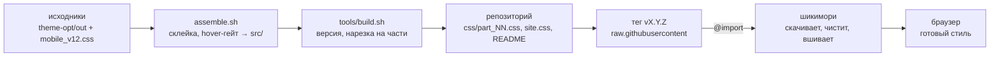

# hikisey theme — архитектура проекта

> подробная карта темы для [шикимори](https://shikimori.one), актуально для **v1.2.21**: где что лежит, как шикимори загружает и чистит css, как устроена палитра, как выходят релизы и чем отличаются телефон и пк.

## содержание

- [коротко](#коротко)
- [репозиторий: файлы и папки](#репозиторий-файлы-и-папки)
- [инструменты сборки](#инструменты-сборки)
- [что внутри исходников src/](#что-внутри-исходников-src)
- [почему тема разбита на части (v1.2.23)](#почему-тема-разбита-на-части-v1223)
  - [main_code_1.css](#main_code_1css--3-356-строк)
  - [main_code_2.css](#main_code_2css--3-990-строк)
  - [main_code_3.css](#main_code_3css--3-885-строк)
  - [main_code_4mob.css](#main_code_4mobcss--7-414-строк)
- [палитра](#палитра)
- [как считаются оттенки](#как-считаются-оттенки)
- [как шикимори загружает и фильтрует css](#как-шикимори-загружает-и-фильтрует-css)
- [site.css: установка и настройка](#sitecss-установка-и-настройка)
- [выпуск релиза](#выпуск-релиза)
- [телефон и пк](#телефон-и-пк)
- [заметные фичи](#заметные-фичи)
- [известные ограничения](#известные-ограничения)
- [история версий](#история-версий)

краткая памятка для правок — в [AGENTS.md](../AGENTS.md), установка — в [README](../README.md).

## коротко

| | |
|---|---|
| **репозиторий** | github.com/Hikisey/shikimori-theme |
| **текущая версия** | v1.2.23 (подвал сайта: «hikisey theme v1.2.23»); карта строк ниже — по v1.2.21 |
| **основа** | тема E-design от ed-main, переписанная и расширенная |
| **объём** | 4 исходника в `src/`, около 18 700 строк и 537 КБ без сжатия; выпускаются 7 частями `css/part_NN.css` по ≤ 80 КБ |
| **подключение** | 7 строк `@import` с тегом версии + блок палитры в «Внешнем виде сайта» |
| **без js** | всё сделано на чистом css: шикимори не пускает скрипты в стили |



## репозиторий: файлы и папки

| путь | зачем |
|---|---|
| `src/main_code_1.css` | палитра и производные оттенки, шрифты, база страницы, раскраска текста, списков, оценок, новостей |
| `src/main_code_2.css` | подпись темы в подвале (`--theme-name`, `--theme-version`), статусы и метки, совместимость, каталог, ачивки, коллекции |
| `src/main_code_3.css` | отзывы, настройки, редактор css, спойлеры, наборы вкладок, верхняя панель |
| `src/main_code_4mob.css` | все брейкпоинты, наборы «О себе», доработки оформления, общий компонент полей, весь телефонный слой и новые фичи v1.2.x |
| `css/part_01.css` … `css/part_07.css` | то, что подключается: те же исходники подряд, нарезанные `tools/build.sh` на части ≤ 80 КБ между правилами (каскад не меняется). руками не правятся |
| `tools/build.sh`, `tools/split_css.py` | сборка частей из `src/` и подстановка версии в подвал |
| `site.css` | готовый стиль для вставки: 2 сторонних импорта, 7 импортов темы с тегом, палитра с комментариями, дополнительные блоки |
| `README.md` | установка, таблица палитры, пример перекраски, заметки |
| `bg.webp` | обои для пк (около 750 КБ) |
| `bg_m.webp` | лёгкие обои для телефона, 900×1440, около 180 КБ |
| `docs/screenshot.jpg` | скриншот темы по умолчанию для README |
| `docs/example_override.jpg` | скриншот примера с синим акцентом для README |
| `docs/ARCHITECTURE.md` | этот документ |
| `AGENTS.md` | короткая навигация и жёсткие правила для правок (для ai-ассистентов и людей) |

исходники лежат в `src/`, подключаемые файлы — в `css/`.

## инструменты сборки

в репозитории: `src/` (собранные исходники) и `tools/build.sh` + `tools/split_css.py` (нарезка на части). рабочие исходники до склейки и проверочные скрипты хранятся отдельно, в локальной папке автора.

| что | зачем |
|---|---|
| исходники `main_code_1…4mob` | основная часть темы, без телефонного хвоста |
| `mobile_v12.css` | весь телефонный слой и фичи v1.2.x, дописывается в конец `main_code_4mob.css` |
| `assemble.sh` | копирует исходники в `src/`, дописывает `mobile_v12.css`, убирает старый vk-баннер, запускает `gate_hover.js`, затем `tools/build.sh` (версия и нарезка на части) |
| `gate_hover.js` | заворачивает любые `:hover`-правила в `@media (hover: hover) and (pointer: fine)` |
| `shiki_compile.py` | эмуляция фильтра шикимори (SanitizeEvilCss + camo): показывает, что останется от css после загрузки |
| `shiki_url_check.py` | проверка, что после camo ни одна ссылка не «съела» соседний код |
| `colors_scan.js`, `recolor.js`, `palette.py` | перевод цветов на переменные (v1.2.20) |
| сохранённые страницы шикимори | пк и телефон, для скриншотов до/после |

## что внутри исходников src/

диапазоны строк примерные, по версии v1.2.21 (тогда файлы лежали в `css/`). у каждого файла свой порядок: старые блоки ed-main идут первыми, новые доработки — в конце.

### main_code_1.css — 3 356 строк

| строки | что |
|---|---|
| 1–58 | палитра: акцент, фон, стекло, текст, статусы (`@media (min-width: 1px) { html:root }`) |
| 59–135 | производные оттенки — запасные значения числами |
| 136–209 | те же оттенки, вычисленные из палитры (`@supports (color: rgb(from red r g b))`) |
| 210–214 | цвет ссылок для светлой схемы сайта |
| 215–270 | `@font-face`: Comfortaa (кириллица/латиница), FontAwesome |
| 270–360 | html/body, затемнение обоев `body:after`, липкая верхняя панель |
| 363–730 | цвет текста, вкладки под ником, заголовки, описание аниме, кнопки статусов списка, жанры, хронология |
| 730–1070 | шкалы, ники, «загрузить ещё», оценки и звёзды, цвета шкал аниме и манги |
| 1067–1310 | списки аниме и манги, «развернуть», поиск и фильтры списка |
| 1319–1510 | теги уведомлений, новости |
| 1510–2510 | кнопки, редактор текста, история, общие компоненты |
| 2510–3080 | прочие блоки с hover-гейтом |
| 3083–3356 | промежуточные брейкпоинты и мелкие телефонные фиксы |

### main_code_2.css — 3 990 строк

| строки | что |
|---|---|
| 1–108 | подпись в подвале: `--theme-name`, `--theme-version`, `content` футера |
| 109–560 | метки и статусы тем (релиз, эпизод, новость, отзыв, анонс…) |
| 561–700 | темы дня, турниры |
| 700–840 | значки и шкала совместимости |
| 840–1365 | общие элементы, полосы прокрутки |
| 1367–1713 | каталог |
| 1713–2300 | страницы пользователя и разное |
| 2301–2340 | ачивки |
| 2681–2770 | авторы, коллекции, навигация почты и клубов |
| 3553–3990 | проекты, затемнение просмотра картинок (mfp), обратная связь |

### main_code_3.css — 3 885 строк

| строки | что |
|---|---|
| 1–1540 | продолжение базы: комментарии, топики, страницы пользователя |
| 1542–1835 | mfp, обратная связь, страница настроек, рецензии, списки, график активности, контент, цвета совместимости |
| 1835–2335 | быстрая ссылка на css, полосы прокрутки |
| 2335–2404 | тёмный редактор css (CodeMirror) |
| 2405–2488 | спойлеры (grin3671 / Enginier) |
| 2489–3155 | наборы вкладок `use-tabs` (вертикальные, ripple, tabline, centered, stretch) |
| 3155–3480 | разное |
| 3483–3630 | верхняя панель: непрозрачная, мягкая подсветка, выпадающие меню |
| 3630–3885 | фикс загрузки постеров и хвосты |

### main_code_4mob.css — 7 414 строк

| строки | что |
|---|---|
| 1–440 | пк-брейкпоинты (≥768, ≥1025, ≥1075, ≥1200, ≤1290, ≤1199, ≤1100) |
| 441–1218 | планшеты и телефоны ≤1023 (кнопка фильтров 722–762) |
| 1219–2240 | базовый телефонный слой ed-main ≤767 |
| 2240–3080 | маленькие экраны (650, 540, 480, 420, 350) и промежуточные |
| 3080–3400 | отзывы, ачивки |
| 3406–5130 | наборы «О себе»: код Cosmo, «Стандарт», «Ссылки-аниме» v0/v1, со своими брейкпоинтами |
| 5132–5296 | исправления: карточки, верхняя панель, читаемость настроек, мелочи |
| 5297–5683 | оформление: обои с зумом, свои постеры, баннер, ачивки, скругления, ссылки, подвал, плитки настроек, отклик нажатия, ник, свечение под баннером |
| 5684–5979 | общий компонент полей: все select и мультиселекты фильтров |
| 5980–6620 | телефон: обои, карточка фильтров, профиль карточками, стекло под текстом, анимация списков |
| 6621–7036 | v1.2.7 нативные списки на iPhone, v1.2.8 заголовки, v1.2.11 список на пк, v1.2.13 галочки |
| 7037–7304 | v1.2.16–19: ленты кадров и видео, стрелки `::scroll-button`, логотипы студий, иконки сайтов |
| 7305–7414 | v1.2.21: баннер на телефоне, стекло плашек, панель фильтров, кнопка-крестик |

## палитра

все цвета темы пишутся rgb-тройкой «R, G, B», поэтому работает `rgba(var(--x), .5)`. старые имена из прошлых версий понимаются как запасные.

| переменная | по умолчанию | что перекрашивает |
|---|---|---|
| `--accent` | 232, 108, 108 | ссылки, значки, подсветка, активные вкладки, полоски; из него — кнопки, ник, наведение |
| `--link` | = accent | только ссылки |
| `--bg-image` / `-mobile` | обои темы | обои пк и телефона |
| `--bg-color` / `-mobile` | 28,30,33 / 167,148,145 (в site.css: 151,128,128 / 167,148,145) | цвет под обоями, пока они грузятся |
| `--bg-zoom` | 1.08 | приближение обоев на пк |
| `--bg-blur` / `-mobile` | 0px / 1.5px | размытие обоев |
| `--bg-dim` | .5 | затемнение обоев (`body:after`) |
| `--bg-brightness-mobile` | .9 | яркость обоев на телефоне |
| `--profile-banner*` | none, 300px, 170px, center, .5 | баннер профиля: картинка, высота пк/телефон, позиция, свечение |
| `--glass` | 30, 34, 42 | стекло блоков; из него — панель, меню, окна, тени |
| `--glass-light` | 255, 255, 255 | рамки и блики на стекле |
| `--glass-blur` | 5px | размытие под стеклом (Chrome, Firefox) |
| `--text` | 236, 240, 247 | основной текст |
| `--text-2` | 170, 178, 192 | подписи, второстепенный текст; из него — текст полей |
| `--text-3` | 140, 148, 160 | даты, счётчики |
| `--text-strong` | 255, 255, 255 | заголовки карточек, текст на кнопках |
| оценки и шкалы | отдельная группа | `--*-rating`, `--time-filled/empty`, `--anime-*`, `--manga-*` |

около 470 цветов намеренно оставлены числами: статусы списков и меток, золотая страница ачивок, цвета bb-кодов, подсветка кода, бренды vk, ники отдельных людей, радуги и цвета наборов «О себе», маски.

## как считаются оттенки

каждый производный оттенок задан дважды: сначала числом (старые браузеры), потом формулой относительного цвета, которая при значениях по умолчанию даёт ровно то же число.

```css
--accent-dim: rgb(178, 58, 64);   /* запасное значение */
@supports (color: rgb(from red r g b)) {
  html:root {
    --accent-dim: rgb(from rgb(var(--accent)) calc(r * 178 / 232) calc(g * 58 / 108) calc(b * 64 / 108));
  }
}
/* прозрачность — через color-mix */
background: color-mix(in srgb, var(--glass-deep) 55%, transparent);
```

| оттенок | из чего | где |
|---|---|---|
| `--accent-dim` | accent | кнопки, подложка ника |
| `--accent-hover` | accent | кнопки под курсором |
| `--link-hover` | link (к белому) | ссылки под курсором |
| `--glass-deep` | glass | меню, затемнение обоев, стеклянные плашки телефона |
| `--glass-bar` / `-bar-hover` | glass | верхняя панель |
| `--glass-popup` | glass | выпадающие списки, подсказки |
| `--glass-active` | glass | нажатые и выбранные элементы |
| `--glass-shadow` | glass | тени |
| `--text-input` | text-2 | текст в полях |
| `--tone-xxxxxx` (59 шт.) | glass / text / accent | серые и светлые служебные цвета |

перед выпуском v1.2.20 все 1 260 изменённых деклараций сравнивались по вычисленным значениям в Chrome и WebKit, скриншоты при значениях по умолчанию совпали попиксельно (кроме номера версии).

## как шикимори загружает и фильтрует css

1. **вырезает @import** — из «Внешнего вида сайта» достаются все `@import url(...)`, остальное — пользовательский css
2. **скачивает на своём сервере** — каждый адрес качается сервером шикимори (до 2 попыток, таймаут около 5 с), браузер github не видит
3. **кеширует на 8 часов** — ключ кеша — точный адрес; пустой ответ после неудачи тоже может пролежать в кеше 8 часов
4. **чистит (SanitizeEvilCss)** — удаляет комментарии, опасные слова, обратные слэши и лишние data:-картинки
5. **переписывает ссылки (camo)** — картинки идут через прокси шикимори
6. **склеивает** — импорты вшиваются первыми; css без `@media` оборачивается в `@media only screen and (min-width: 1024px)`

| ловушка | что происходит | как обходим |
|---|---|---|
| слово behavior | удаляется везде (`scroll-behavior` → `scroll-`) | плавной прокрутки нет; слово не используем |
| обратный слэш | `\` + буква/цифра удаляется вне строк `content:` | никаких экранирований, кроме иконок в `content` |
| camo и `;` | регулярка ссылки «съедает» `)` и `}` после `url(...)`, если нет `;` | всегда `url(...);` перед `}`, без минификации |
| символ `@` в ссылке | вырезается | ссылки на картинки без `@` |
| data:-uri | остаются только base64 `image/svg+xml\|png\|jpeg\|jpg\|gif` | галочка, play и т. п. — base64 svg |
| `@media`-обёртка | css без `@media` уходит только на ширину ≥1024 | палитра всегда в `@media (min-width: 1px)` |
| другие слова | eval, cookie, window, parent, this, script, expression… | не встречаются в коде и комментариях |

> **ℹ️ ссылки с `//` тоже идут через прокси.** по исходникам шикимори (`Styles::Compile#camo_images` → `generate_camo_url`) регулярка находит в css и `https://…`, и `//…`. ссылке с `//` добавляется протокол, после чего она так же переписывается на camo-прокси шикимори. мимо прокси проходят только адреса доменов самого шикимори (они отдаются без протокола); адреса из списка запрещённых доменов заменяются прозрачной картинкой. в старом коде шикимори прямые ссылки на `//` и `https://` действительно пропускались без прокси, но этот код закомментирован: «прямые ссылки раскрывают ip пользователей». значит, `//` в ссылках на обои ничего не меняет — работает так же, как `https://`.

## site.css: установка и настройка

1. **открыть site.css нужного тега** — raw.githubusercontent.com/Hikisey/shikimori-theme/v1.2.23/site.css
2. **скопировать целиком** — сначала 2 сторонних импорта (тёмный CodeMirror, свои постеры), потом 7 импортов темы
3. **вставить в «Внешний вид сайта»** — заменить всё старое, сохранить, обновить страницу с Ctrl+Shift+R
4. **менять только блок «Палитра»** — `@media screen and (min-width: 1px) { html:root { … } }`, обёртку не удалять

```css
@import url("https://raw.githubusercontent.com/Hikisey/shikimori-theme/v1.2.23/css/part_01.css");
@import url("https://raw.githubusercontent.com/Hikisey/shikimori-theme/v1.2.23/css/part_02.css");
@import url("https://raw.githubusercontent.com/Hikisey/shikimori-theme/v1.2.23/css/part_03.css");
@import url("https://raw.githubusercontent.com/Hikisey/shikimori-theme/v1.2.23/css/part_04.css");
@import url("https://raw.githubusercontent.com/Hikisey/shikimori-theme/v1.2.23/css/part_05.css");
@import url("https://raw.githubusercontent.com/Hikisey/shikimori-theme/v1.2.23/css/part_06.css");
@import url("https://raw.githubusercontent.com/Hikisey/shikimori-theme/v1.2.23/css/part_07.css");
```

`html:root` в палитре нужен, чтобы вес селектора совпал с палитрой темы и пользовательский блок, идущий позже, побеждал.

## выпуск релиза

1. **правка исходников** — `src/main_code_*` (у автора — рабочие `main_code_*` и `mobile_v12.css`), никогда сами файлы в `css/`
2. **сборка** — `VERSION=1.2.23 bash tools/build.sh` (или `THEME_VERSION=1.2.23 REPO=<репозиторий> bash assemble.sh` из рабочих исходников) — версия попадает в `--theme-version` и в подвал, `css/` пересобирается частями ≤ 80 КБ
3. **проверки** — css-tree без ошибок; эмуляция фильтра шикимори сохраняет все правила; ссылки целы; нет behavior и @view-transition
4. **скриншоты до/после** — пк 1280 в Chrome, iPhone 13 в WebKit и телефон в Chrome
5. **версия в site.css и README** — замена старого тега на новый
6. **commit, push, тег, GitHub release** — релиз с описанием на русском
7. **проверка raw-адресов** — все части отдают 200 и побайтно совпадают с репозиторием; если число частей изменилось, обновить строки в `site.css` и README

- теги, а не main: шикимори кеширует каждый адрес на 8 часов, а новый тег — новый адрес, который скачается сразу и не изменится потом
- main только для разработки; в v1.2 пробовали следить за main и сбрасывать кеш `?v=2`, `?v=3` — от этого отказались
- без минификации: в v1.2.9 сжатие склеило `url("…")}`, camo съел скобку и следующие правила пропали; v1.2.10 вернул читаемый вид
- у тега v1.2.4 нет GitHub-релиза; опубликованные теги не переносятся

## почему тема разбита на части (v1.2.23)

на v1.2.21–v1.2.22 шикимори писал «Не удалось импортировать» про `main_code_4mob.css`, а остальные три файла (около 100 КБ каждый) подключались.

| версия | размер 4mob | результат |
|---|---|---|
| v1.2.20 | 225 317 Б | подключался |
| v1.2.21 | 231 438 Б | не подключился |
| v1.2.22 | 233 749 Б | не подключился |

- **что известно.** в старом коде шикимори (Rails) файл качается сервером: таймаут ответа 5 с, соединения 2 с, ответ кроме «200 + UTF-8» превращается в пустую строку и кешируется на 8 часов; пустой импорт и есть «не удалось импортировать». сам файл валиден: UTF-8, парсится, эмуляция фильтра ничего лишнего не вырезает. сайт сейчас работает на новом фронтенде, и точные лимиты нового загрузчика снаружи не видны.
- **вывод.** отказ совпал с ростом файла за отметку около 225–231 КБ, а файлы около 100 КБ грузятся стабильно. скорее всего, у загрузчика есть предел размера ответа или времени загрузки, и большой файл в него не укладывается. содержимое тут ни при чём: те же правила, нарезанные на части, после фильтра дают байт-в-байт тот же css.
- **решение.** все правила подряд режутся на 7 частей не больше 80 КБ (`tools/split_css.py`, только между правилами верхнего уровня). каскад не меняется, а самая большая часть меньше уже проверенных 100 КБ, с запасом.
- **почему не jsDelivr.** по старому коду адрес `cdn.jsdelivr.net/gh/Hikisey/shikimori-theme@v1.2.23/css/…` допустим (`@` в адресе импорта не вырезается, обои с jsDelivr уже идут через camo). но ограничения нового загрузчика по хостам проверить снаружи нельзя, а raw.githubusercontent с тегом проверен на всех прошлых версиях. поэтому основной путь — raw, а jsDelivr — запасной: те же пути, `@vX.Y.Z` вместо `/vX.Y.Z`. на jsDelivr ограничения размера не помогли бы — если дело в размере, большой файл не пройдёт и оттуда.
- **после выпуска** все адреса открываются один раз (прогрев кеша GitHub). если неудача уже закешировалась у шикимори, адрес из сообщения сбрасывается на `shikimori.io/tests/reset_styles_cache`.

## телефон и пк

| что | как |
|---|---|
| брейкпоинты | пк ≥1024 (баннер и ачивки ≥1200), планшет 768–1023, телефон ≤767, мелкие экраны 650/540/480/420/350 |
| правки только для телефона | только внутри `@media screen and (max-width: 767px)` |
| наведение | любой `:hover` только в `@media (hover: hover) and (pointer: fine)`, на сенсорах — короткий отклик нажатия |
| списки | на сенсорных экранах select — системный (колёсико iOS); на пк — общий компонент поля с анимацией |
| стекло | на телефоне плашки с `backdrop-filter`; для Safari сила размытия записана числом |
| обои | отдельный лёгкий кадр `bg_m.webp`, лёгкое размытие 1.5px и яркость .9 |
| фильтры | карточка по центру экрана, плотное матовое стекло, списки раскрываются через grid-rows 0fr↔1fr |

## заметные фичи

| фича | версия | как сделано |
|---|---|---|
| ленты кадров и видео | v1.2.16–17 | горизонтальная прокрутка со scroll-snap, 16:9, play-кнопка из base64 svg, заголовок и лента — одна стеклянная панель |
| стрелки лент | v1.2.17 | `::scroll-button(*)` (Chromium 135+), только пк с мышью, под `@supports selector(...)` |
| логотипы студий | v1.2.18–19 | скругление, контур 1px через drop-shadow; чёрные прозрачные логотипы (id 11, 44, 858) — белым силуэтом; подъём на 3px |
| иконки сайтов | v1.2.18 | светлый круглый бейдж 20px под favicon в «На других сайтах» |
| галочки | v1.2.13–15 | круг 18px по середине строчных букв, svg-галочка растёт и сжимается |
| фильтры | v1.2–1.2.21 | общий компонент полей, плавное раскрытие, карточка на телефоне |
| баннер профиля | v1.0, v1.2.21 | пк: 300px над шапкой со свечением; телефон: 170px сверху, аватар на нижнем крае |
| палитра | v1.2.20 | все цвета на переменных, 4 группы |

## известные ограничения

- нет плавной прокрутки по стрелкам: шикимори вырезает слово behavior, обход через экранирование тоже вырезается
- в режиме списка у шикимори в разметке нет постеров, css их не добавит
- Safari: `-webkit-backdrop-filter` не понимает `var()`, поэтому `--glass-blur` действует только в Chrome и Firefox
- до Chrome 119 и Safari 16.4 производные оттенки не пересчитываются, остаются цветами по умолчанию
- режим блокировки iPhone (Lockdown Mode) не отключает backdrop-filter, но блокирует часть веб-шрифтов и экспериментальные функции
- стрелки `::scroll-button` есть только в Chromium 135+, в остальных браузерах лента листается свайпом и колесом
- старые имена палитры для оттенков (`--buttoms-color`, `--menu-back`, `--popup-color`…) больше не задаются отдельно

## история версий

| версия | что изменилось |
|---|---|
| v1.0–v1.1 | своя тема на основе ed-main: обои, баннер, общий компонент полей, анимации списков, яркие иконки сервисов |
| v1.2 | облегчение кода, фиксы select, телефон: размытые обои, карточка фильтров, плитки действий |
| v1.2.1 | жидкое стекло фильтров, поля 16px, профиль карточками |
| v1.2.2 | строка «Время за аниме» над шкалой |
| v1.2.3 | читаемость на телефоне: тень текста, стекло под заголовками и блоками |
| v1.2.4 | обои снова с лёгким размытием 1.5px |
| v1.2.5 | мягче стекло на телефоне |
| v1.2.6 | плавное сворачивание списков фильтра |
| v1.2.7 | iPhone: системный select, без клавиатуры в коротких списках |
| v1.2.8 | hover только для мыши, отклик нажатия на сенсорах |
| v1.2.9 | сжатие 4mob — сломало правила после url (camo) |
| v1.2.10 | возврат к читаемому виду |
| v1.2.11–12 | список аниме на пк: стеклянные заголовки и поиск |
| v1.2.13–15 | галочки по тексту, подпись темы в подвале, svg-галочка по центру |
| v1.2.16 | кадры и видео лентами сразу после описания |
| v1.2.17 | стрелки лент, одна стеклянная панель, логотипы студий |
| v1.2.18 | адаптивные логотипы, бейджи иконок сайтов |
| v1.2.19 | чёткие логотипы, подъём на 3px вместо алого свечения |
| v1.2.20 | все цвета на переменных: акцент, фон, стекло, текст |
| v1.2.21 | стекло на iPhone снова размыто, баннер на телефоне, плотная панель фильтров, кнопка-крестик на экране |
| v1.2.23 | тема подключается 7 частями по ≤ 80 КБ вместо 4 файлов (4mob на 234 КБ перестал импортироваться); исходники в `src/`, сборка `tools/build.sh`; короткий README |
| v1.2.22 | наведение без «мигания» у нижнего края: плитки сервисов в настройках стоят на месте (поднимается значок), под поднятыми карточками — невидимая полоска, кадры и видео растут от нижнего края, кнопки без сдвига на 1px; подсказки `.tipsy` не перехватывают курсор |
